# Purgeon

## TL;DR

Purgeon helps you remove Windows programs and inspect what they leave behind.
Review the proposed changes and backups before deleting anything.

A Windows uninstaller that removes a program and then finds the files, folders, registry keys, startup entries and services it left behind.

It can also:
- notice installers as they start, and record what they install;
- monitor installations and compare before-and-after snapshots;
- let you try a program and then undo it completely;
- analyze any program: what it hooks into Windows, its disk use, when it was last used, and what needs it;
- find leftovers of programs you removed long ago;
- show where your disk space goes, program by program;
- move programs, or a whole PC's worth, to another PC;
- clean junk files and privacy traces;
- update programs with winget;
- manage everything that runs with Windows, and Explorer's right-click menu.

Every change is backed up first and can be undone.

It has a compact single-list window with a dark terminal theme. It is built with [Tauri](https://tauri.app/) and React on Microsoft Edge WebView2.

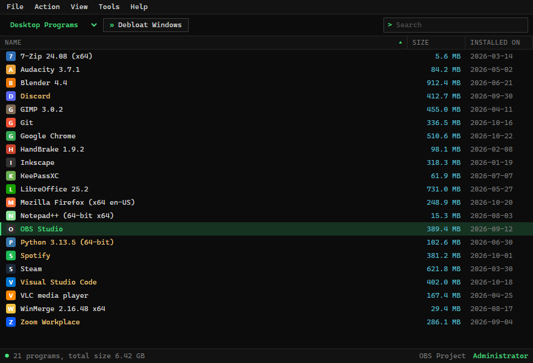

**Contents:**
- [Toolbars and commands](#toolbars-and-commands)
- [Program list](#program-list)
- [Uninstall and leftover scan](#uninstall-and-leftover-scan)
- [Batch uninstall and the uninstall queue](#batch-uninstall-and-the-uninstall-queue)
- [Installation monitor](#installation-monitor)
- [Trial installs](#trial-installs)
- [Snapshots](#snapshots)
- [Change timeline](#change-timeline)
- [Analyze a program](#analyze-a-program)
- [What a program does](#what-a-program-does)
- [Disk space map](#disk-space-map)
- [Program migration and settings sync](#program-migration-and-settings-sync)
- [Uninstall Archive](#uninstall-archive)
- [Who owns this?](#who-owns-this)
- [Orphaned leftovers and registry search](#orphaned-leftovers-and-registry-search)
- [Program updates](#program-updates)
- [Portable apps](#portable-apps)
- [Cleaner](#cleaner)
- [Browser clean-up](#browser-clean-up)
- [Startup & Services](#startup--services)
- [Explorer context menu](#explorer-context-menu)
- [Debloat](#debloat)
- [Program groups](#program-groups)
- [Scheduled maintenance, tray and reports](#scheduled-maintenance-tray-and-reports)
- [Themes and accessibility](#themes-and-accessibility)
- [Safety, backups and undo](#safety-backups-and-undo)
- [Command line](#command-line)
- [Download](#download)

Screenshots use demo data. QuickPDF Free, SearchBoost Toolbar and OldPhotoTool are made-up examples.

## Toolbars and commands

**Views** are a column of icons on the left: **Programs**, **Apps**, **Monitored**, **Startup**, **Debloat**, **Cleaner**, **Snapshots**, **Archive** and **Timeline**. Hover over one for its name, what it shows and its shortcut. Click an open tool view again to go back to the program list.

Under the menu bar are three rows:
- **Search and commands:** one box searches the open list as you type. It also lists menu commands whose names match; press `↓` and `Enter` to run one, or `Esc` to clear the box. **All commands** (`Ctrl+K`) opens the command palette with every command and program.
- **Details:** the selected program with its version, publisher, size, architecture, install date and group, or what to do in the open view when nothing is selected. The group picker sits at the end of this row.
- **Actions:** buttons only: Uninstall, Force, Analyze, Leftovers, What’s This, Migrate, Queue, Group, Hide, Folder, Registry, Search Online and Properties. When they don’t fit on one row, they continue on the next instead of being cut off. With several programs selected it shows the batch actions, and other views show their own (Take Snapshot and Compare in Snapshots, for example).

The menu bar is also the window’s title bar: drag its empty middle to move the window, and double-click it to maximize. At its right end are the elevation status (**Not Elevated – Restart as Administrator**, or **Administrator**), then a 📌 thumbtack that keeps Purgeon on top of other windows (green while on), and the minimize, maximize and close buttons. Messages (👍 for done, ⚠️ for warnings, ⛔ for errors) appear at the bottom, just above the status bar.

**Tooltips everywhere:** hover over any menu item, button, view icon, field, column header or list row to see what it is and what it does, including what it changes and how to undo it.

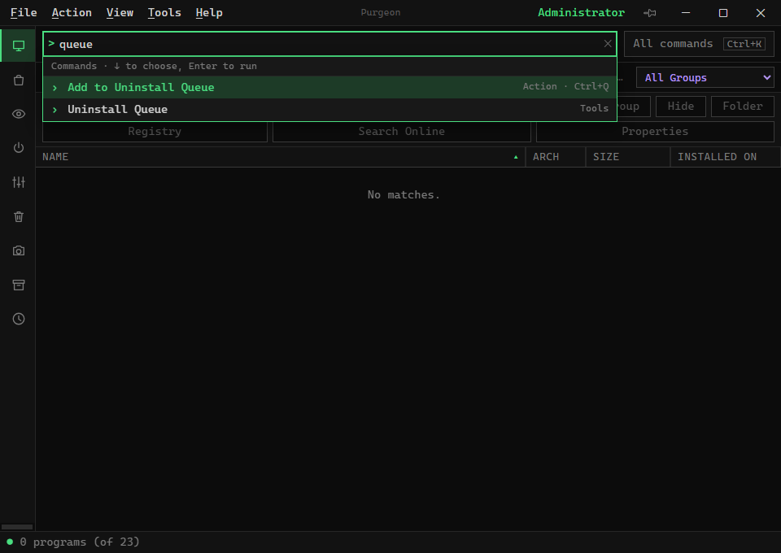

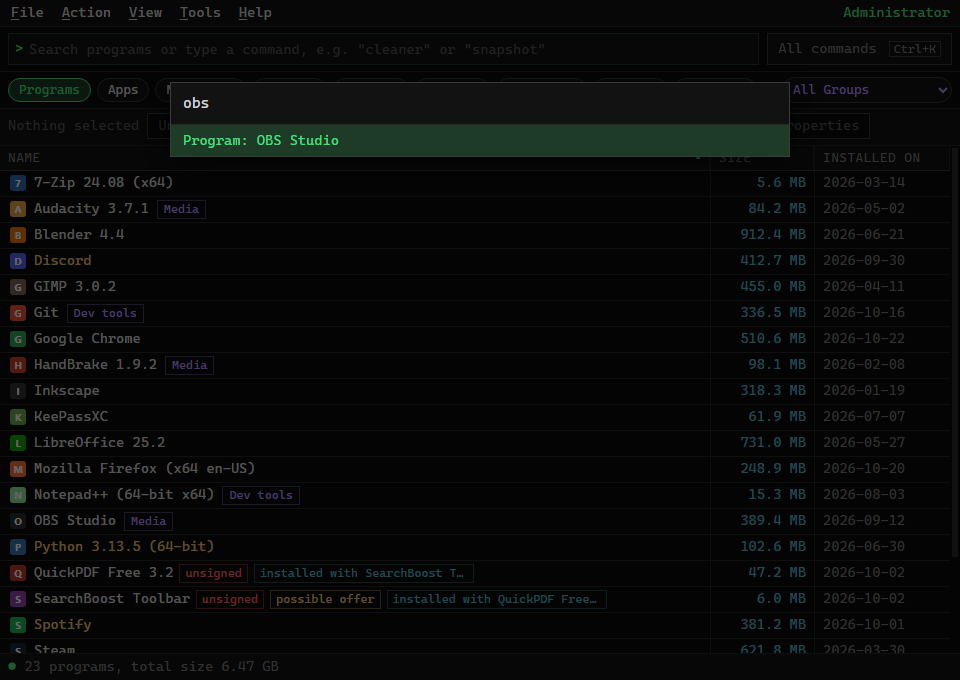

## Program list

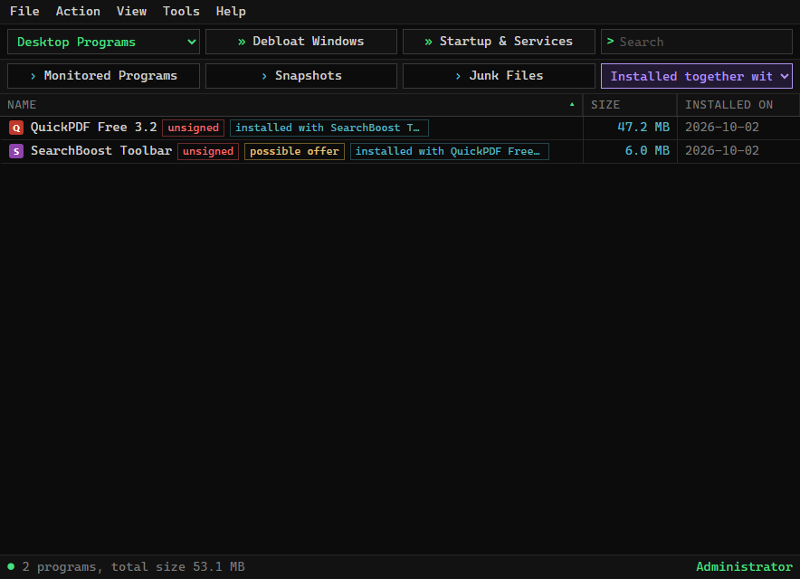

- **Lists:** desktop programs from all three registry uninstall locations (64-bit, 32-bit and per-user) with icons, size and install date, plus Windows Store apps. Programs installed only for the current user are shown in amber.
- **Measured values:** when a program doesn't report its size or install date, Purgeon measures its folder in the background. Measured values are in italics; hover one to see which folder it came from.
- **Finding programs:** sort by any column, search instantly, or type the first letters to jump.
- **Architecture:** the **Arch** column shows whether each program is 64-bit, 32-bit or ARM64, read from its program file’s header. When the file can’t be found, it falls back to the part of the registry Windows lists it in, and the tooltip says which. (.NET programs built for “Any CPU” show as 32-bit there but run as 64-bit.)
- **Insight tags** after a program's name show:
  - **unsigned** or **bad signature**: the program's own file isn't digitally signed, or its signature is broken;
  - **installed with …**: it was installed or updated within two minutes of a program from another publisher, which is how bundled offers usually arrive;
  - **possible offer**: its name matches a type of program often installed as a bundled offer (toolbars, "PC optimizers", search helpers);
  - **growing**: it grew by a fifth and at least 50 MB over the last 90 days.
- **Filters and details:** the group picker also filters by each insight. **Properties** (`Alt+Enter`) shows the signer, what it was installed with, and its size history.
- **Hiding entries:** **Action › Hide From List** hides programs you never want to see in the list, such as runtimes and drivers. They stay installed and Windows still lists them; only Purgeon's list hides them. The status bar counts them. **View › Show Hidden Programs** (or a click on that count) shows them dimmed and tagged **hidden**, and **Action › Unhide** brings one back.
- **Removed elsewhere:** when a program disappears through Windows Settings, its own uninstaller or another tool, Purgeon notices on the next start and offers a leftover scan.
- **Display:** the window fits your screen and respects Windows' display scale. Zoom with `Ctrl++` / `Ctrl+-` / `Ctrl+0`. **View › Grid Lines** (on by default) separates rows and columns.

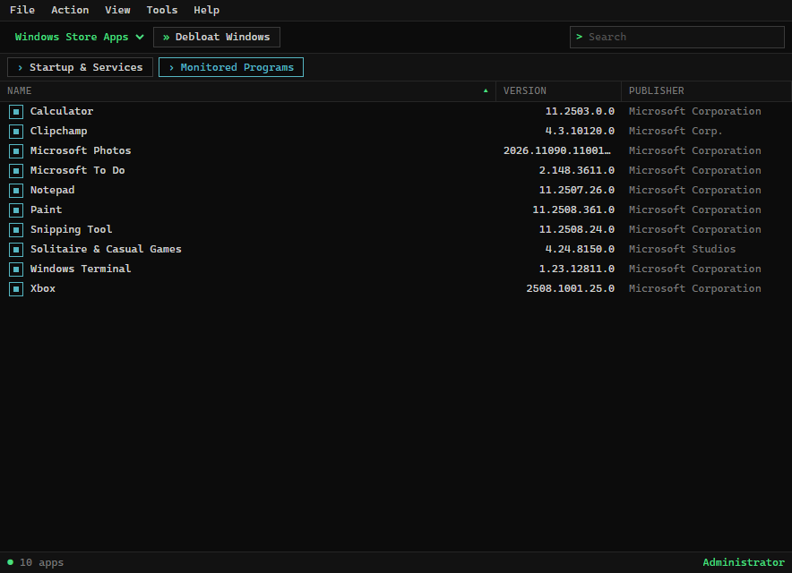

## Uninstall and leftover scan

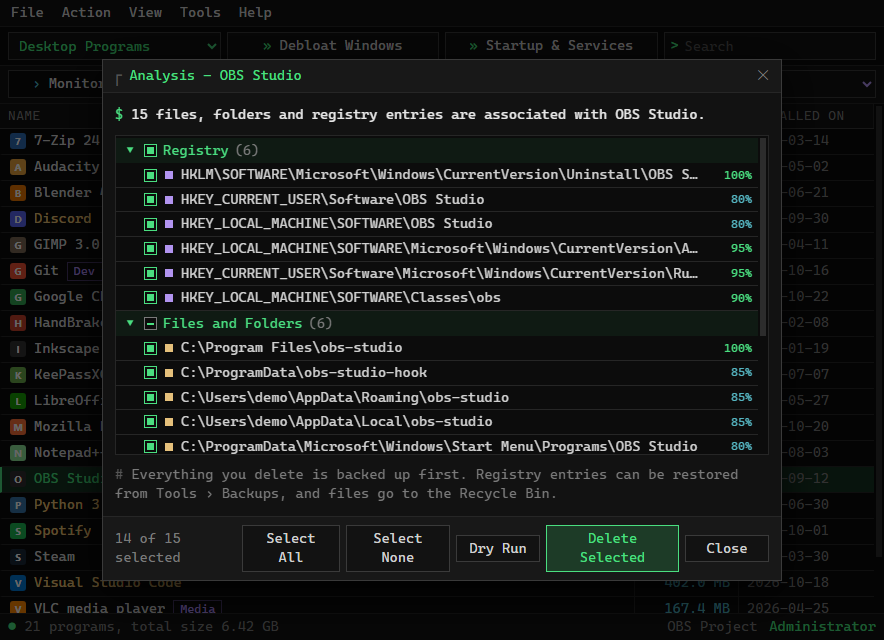

**Running the uninstaller**
- Purgeon runs the program's own uninstaller and waits for it to finish, including Inno Setup and NSIS uninstallers that relaunch themselves from `%TEMP%`.
- It recognises how the program was installed: Windows Installer, Inno Setup, NSIS, WiX bundle or InstallShield.
- **Installer records:** before uninstalling, it reads the exact list of files and settings the installer recorded (the Windows Installer package cached for the program, or the Inno Setup uninstall log). Those records disappear during the uninstall. Anything they list that is left behind is offered with a 95–100% match.
- **Tools › Silent Uninstall When Possible** runs Windows Installer, Inno Setup, NSIS and WiX uninstallers without their windows. Other uninstallers show their window as usual, because Purgeon never guesses switches.
- **Dependency warnings:** the confirmation warns before you remove a shared runtime (Visual C++, .NET, Java, DirectX and others), a hardware driver, or a program that other installed programs registered a need for.

**Then it scans for leftovers:**
- the install folder;
- folders named after the program or its publisher in Program Files, ProgramData and AppData;
- Start Menu and desktop shortcuts;
- `Software` registry keys, App Paths and startup Run entries;
- services, scheduled tasks and firewall rules;
- Explorer right-click entries, shell extensions, file types and URL handlers;
- data and cache folders named after the program's own executables.

**Choosing what to remove**
- Every item gets a **match score** from 0 to 100%. Items scoring 70% or more start ticked; weaker guesses start unticked and are marked **check**.
- Publisher folders count only when named exactly after the publisher, so removing one Google program never offers another's folders.
- **Force** (`Shift+Del`) handles programs whose uninstaller is broken or missing.
- **Rescue Broken Uninstall** reinstalls the program through winget over the existing copy, which puts a working uninstaller back, then uninstalls it normally.
- **Analyze Leftovers** (`Ctrl+L`) shows what belongs to a program without uninstalling it.
- Running processes in the install folder are detected and can be closed first.

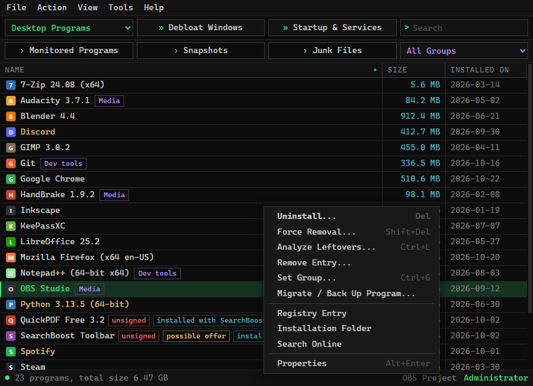

## Batch uninstall and the uninstall queue

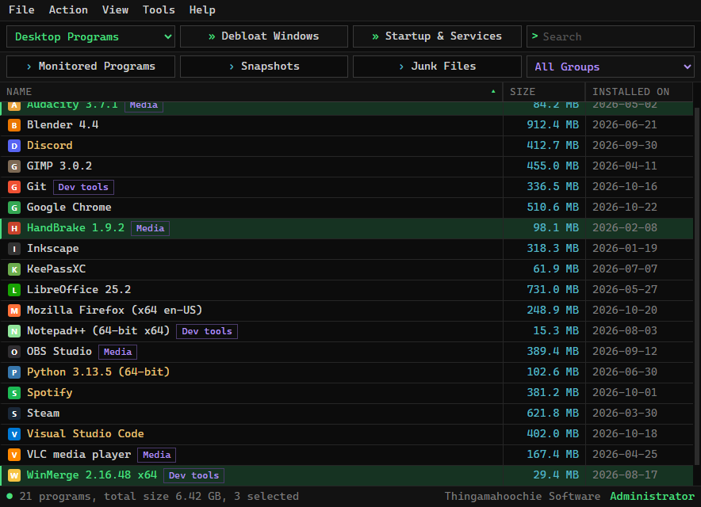

- **Selecting:** use `Ctrl+click`, `Shift+click`, `Shift+arrows` or `Ctrl+A`, then press `Del`. This works for desktop programs and Store apps.
- **Confirmation:** it shows each program's installer type and any dependency warning.
- **Running:** each uninstaller runs in turn, silently where possible. **Stop After This One** cancels the rest of the batch.
- **Afterwards:** one combined leftover list shows every program's files, folders, registry entries and services, grouped by program.

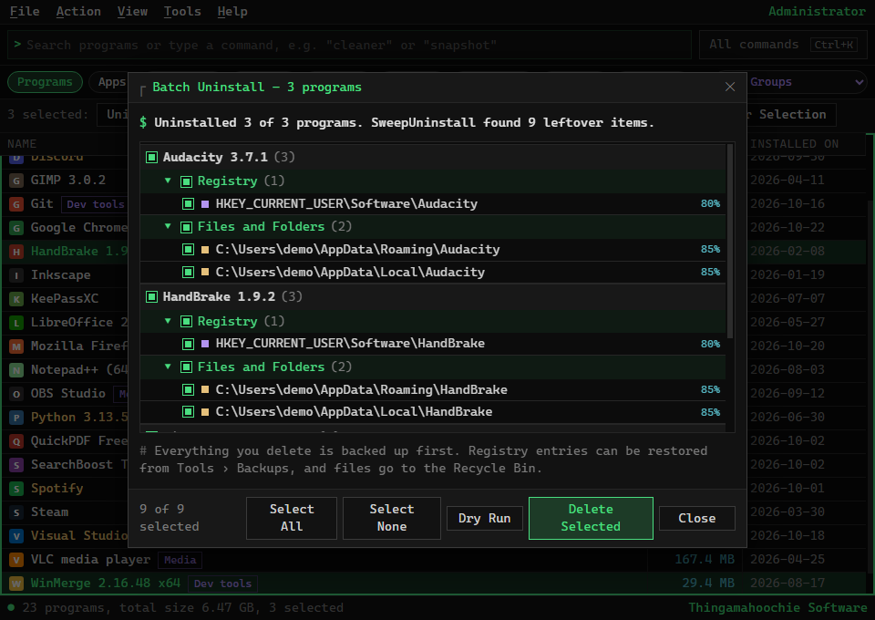

**Uninstall queue** (**Tools › Uninstall Queue**, add programs with `Ctrl+Q`):
- Programs are uninstalled one after another, silently where possible, so you don't have to watch.
- If an uninstaller needs a restart, the queue is saved and Purgeon starts once after you sign back in to continue. It uses a RunOnce entry, which Windows removes after using it.
- At the end, every program's leftovers are shown together for you to review.

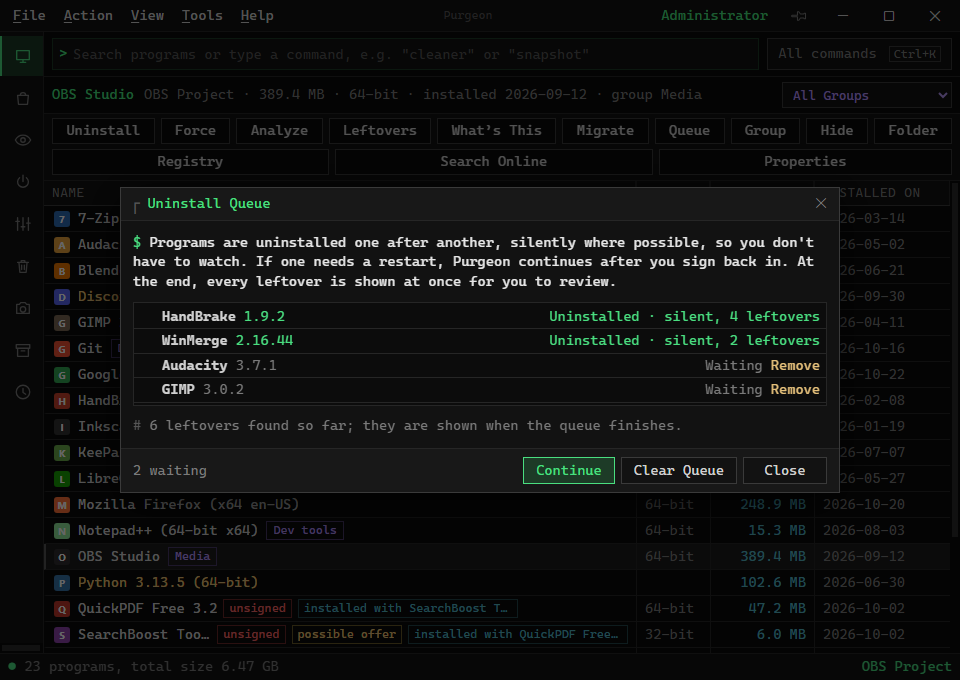

## Installation monitor

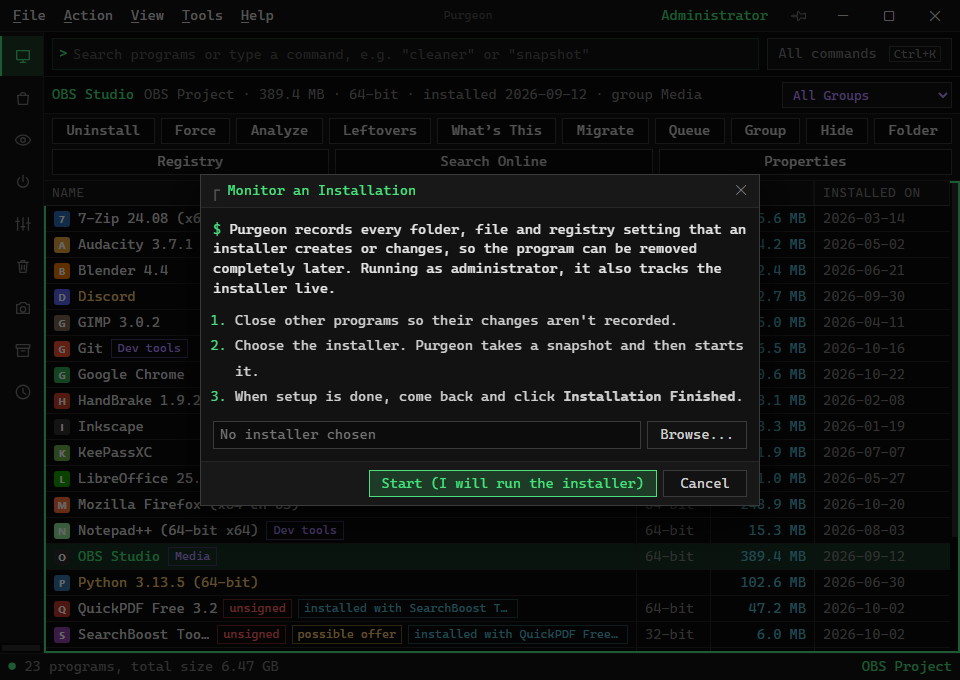

- **Tools › Monitor an Installation** (`Ctrl+M`) works in four steps:
  1. takes a snapshot of the file system and registry;
  2. runs your installer;
  3. takes a second snapshot;
  4. records every folder, file, registry key, registry value and service that was added.
- **Live tracking:** run as administrator, it also follows the installer with Windows' own event tracing. It records every file and registry change by the installer, the programs it starts and Windows Installer, as it happens and at any depth. Temporary files and Windows' bookkeeping are left out.
- **Changed settings:** existing settings the installer changed (a file association, a replaced Run entry) are recorded and put back when you uninstall.
- **Monitored Programs** (`Ctrl+3`) lists the recordings. Uninstalling one removes exactly what its installation created.
- **Command line:** `Purgeon --monitor "setup.exe"` records an installation without the window.

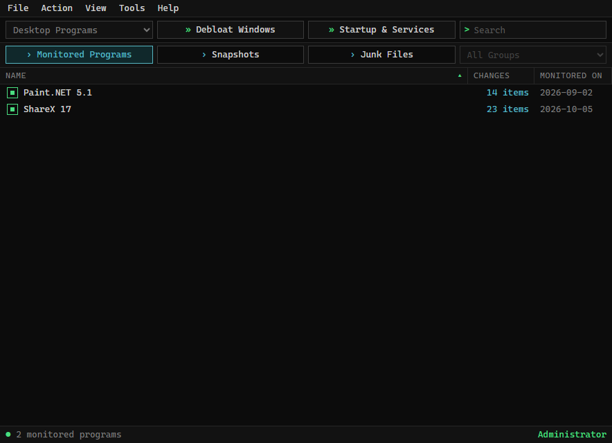

**Detecting installations:** while Purgeon runs, including from the tray, it notices installers starting and asks whether to record them. It brings its window forward and shows a Windows notification.
- **Monitor It** takes the "before" snapshot while the installer waits on its first page, then you install as usual and click **Installation Finished**.
- It looks only at new programs started in your own Windows session, named like an installer (`setup`, `install`) or Windows Installer opening an `.msi`. Uninstallers, Windows' own servicing, its own program updates and trial installs are left out.
- An installer that was already running is recorded with snapshots only; live tracking follows installers Purgeon starts itself.
- **Tools › Detect Installations** turns it off.

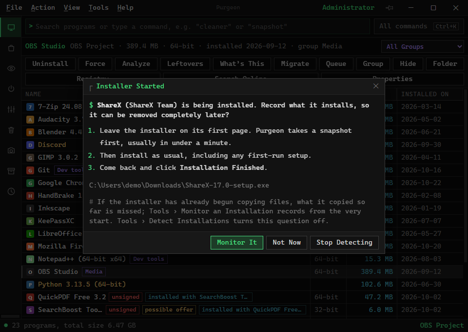

## Trial installs

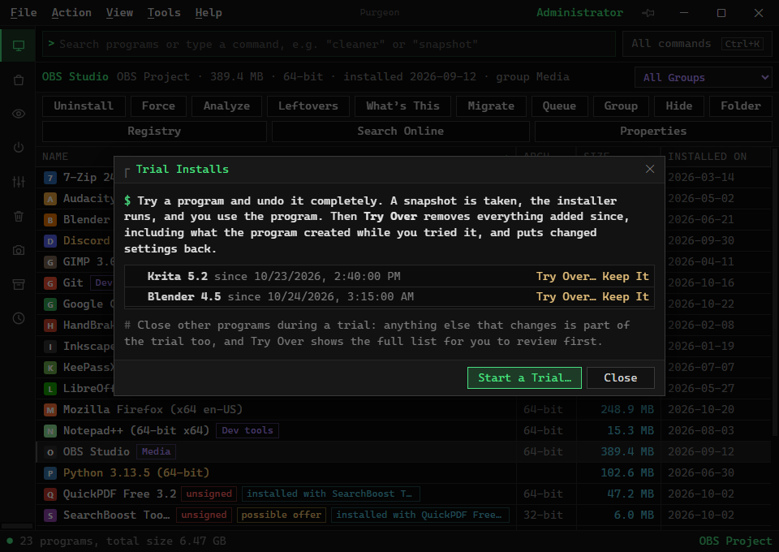

- **Tools › Trial Installs** lets you try a program and undo it completely.
- A snapshot is taken, the installer runs, and you use the program for as long as you like.
- **Try Over** removes everything added since the snapshot, including what the program created while you tried it, and puts changed settings back. You review the full list first, and everything removed is backed up.
- **Keep It** ends the trial and keeps the program.
- Close other programs during a trial: anything else that changes is part of the trial too.

## Snapshots

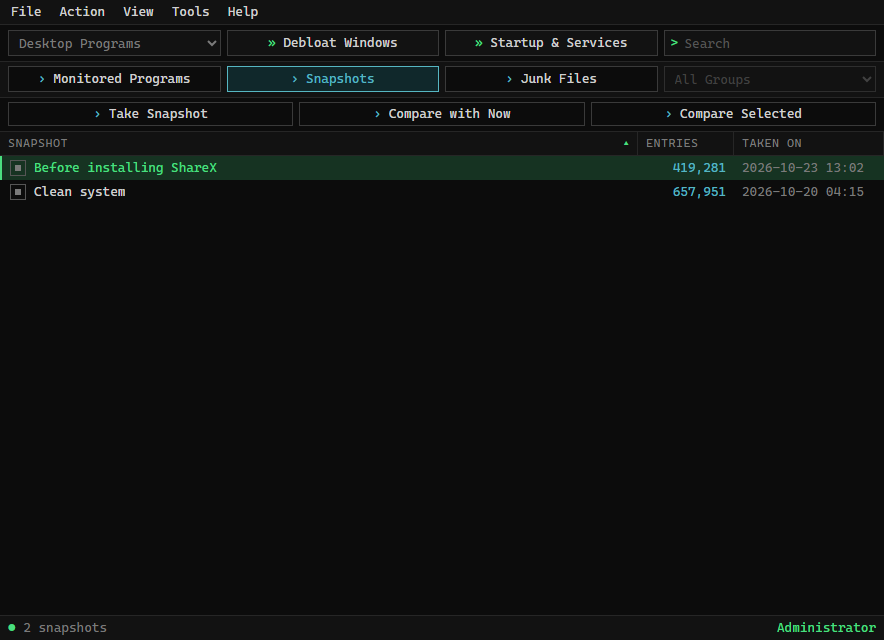

- **What a snapshot records:** **Snapshots** (`Ctrl+7`) keeps named records of Program Files, ProgramData, AppData, the Start Menu and desktops, and the software and services parts of the registry. Temporary files and caches are left out.
- **Depths:** **Quick** (a few seconds), **Standard** or **Deep**.
- **Timeline:** it shows your snapshots in order. Click one, then Ctrl+click a second to compare them, or click **Now**.
- **Comparing:** a comparison shows what was **added**, **removed** and **changed**, with old and new registry values side by side. You can filter by files or registry, search, and export to HTML.
- **Clean Up Selected** removes added items, and puts changed or removed registry values and keys back from the earlier snapshot. Everything is backed up and undoable, and **Dry Run** shows what it would do first.

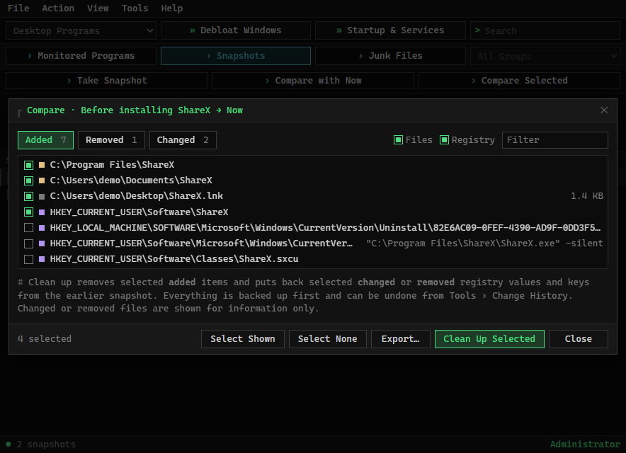

## Change timeline

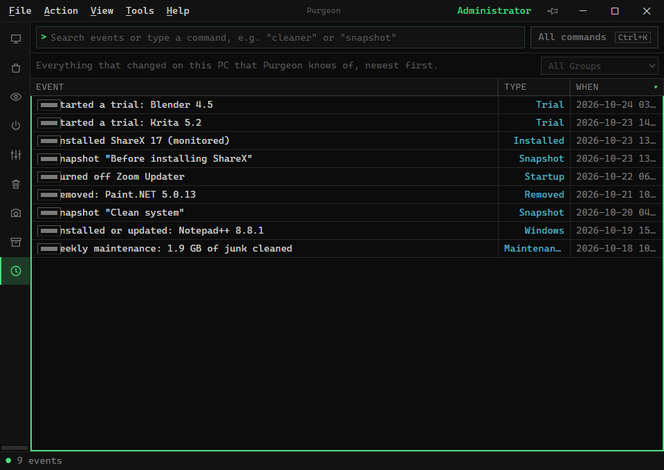

**Timeline** (`Ctrl+T`) answers "what changed on this PC last Tuesday?". It joins, newest first:
- installs and updates Windows recorded;
- monitored installs, trials and snapshots;
- removals, including programs removed outside Purgeon;
- everything in Change History, such as startup changes and clean-ups.

## Analyze a program

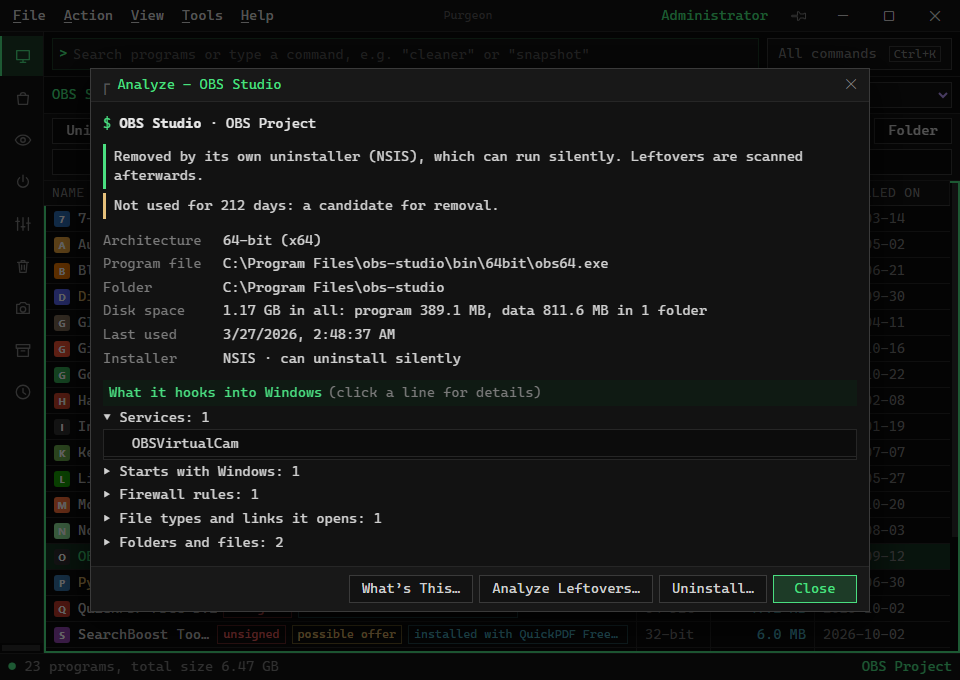

**Analyze** (`Ctrl+I`) gives one read-only report on the selected program:
- a short verdict: how it will be removed (its own uninstaller, silently or not, or Force when it has none), whether it is running now, whether other programs need it, whether it is signed, and whether it has gone unused for half a year;
- its architecture and main program file;
- disk space: its install folder plus the data folders named after it;
- when it was last used, from Windows' Prefetch records (as administrator);
- how it was installed;
- what it hooks into Windows, with a count for each kind; click one to see them.

From there, **Uninstall**, **Analyze Leftovers** and **What’s This** are one click away.

## What a program does

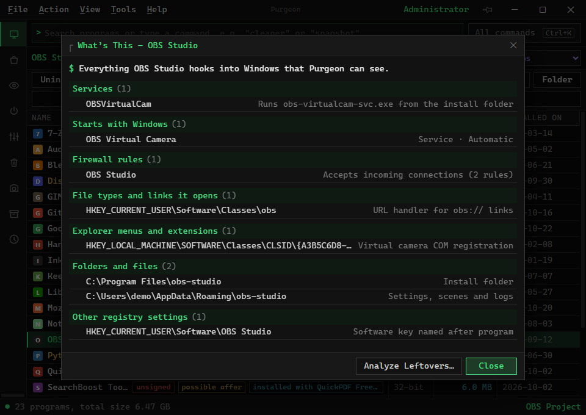

**What’s This** (`Ctrl+W`) lists, on one page, everything a program hooks into Windows: services, scheduled tasks, startup entries, firewall rules, file types and links it opens, Explorer menus and extensions, its folders, and other registry settings.

## Disk space map

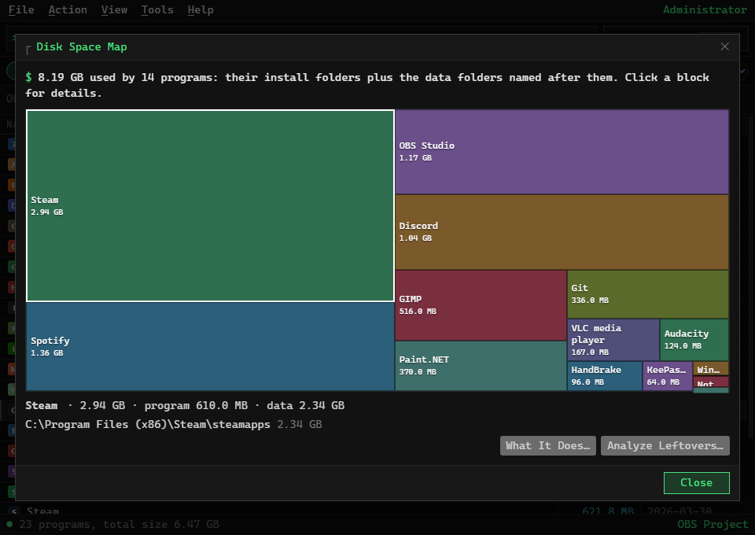

- **View › Disk Space Map** draws each program as a block sized by its install folder plus the data folders named after it in ProgramData and AppData.
- Click a block to see its biggest folders, then open **What’s This** or **Analyze Leftovers** for that program.

## Program migration and settings sync

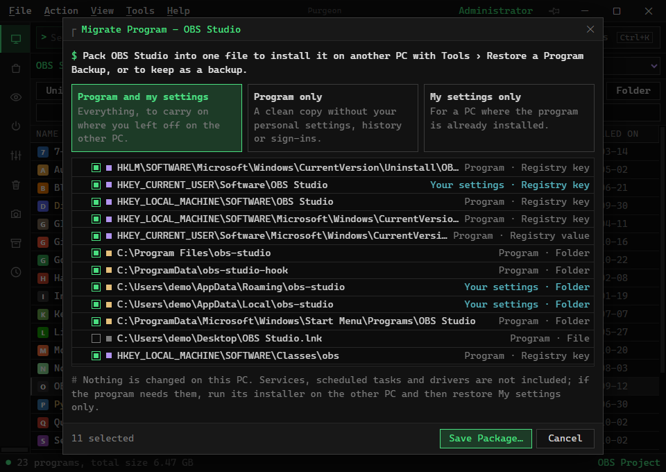

- **Packaging:** right-click a program and choose **Migrate / Back Up Program** to pack it into one `.swpkg` file. Choose one of:
  - **Program and my settings**: everything, to carry on where you left off;
  - **Program only**: a clean copy without your settings, history or sign-ins;
  - **My settings only**: for a PC where the program is already installed.
- **What counts as what:** each item is marked as part of the program (install folders, shortcuts, machine-wide settings, the uninstall entry) or as your settings (AppData, documents, per-user registry). Nothing on this PC changes.
- **Restoring:** **Tools › Restore a Program Backup** restores it on any PC. Paths in the old user profile and the old user's registry settings are moved to the new user.
- **Safety:** a restore never overwrites existing folders or files. Existing registry keys are saved before anything is merged into them, and the whole restore can be undone.
- **Limits:**
  - Services, scheduled tasks and drivers are not included.
  - Programs installed by Windows Installer run after a restore, but need their installer to repair or update them later; the restore says so.

**A whole PC:** **File › Migrate This PC** packs the programs you choose into one folder, one package each, plus a winget list of all your programs. On the new PC, **File › Restore Programs From Folder** restores the packages with the same checks, and `winget import` installs the rest.

**Settings sync:** **File › Settings Sync** keeps chosen programs' settings the same on your PCs through a shared folder, such as one in OneDrive. **Send My Settings** saves this PC's settings there, and **Get Settings** brings in newer ones from another PC. The settings being replaced go to the Recycle Bin first, and the change can be undone from Change History.

## Uninstall Archive

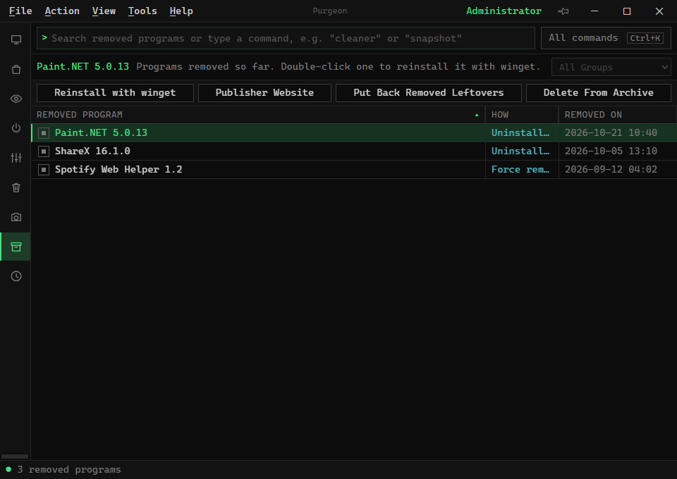

- **View › Uninstall Archive** (`Ctrl+9`) keeps a record of every program you removed: when, how (uninstalled, force removed, Store app) and its removal backups.
- Right-click an entry to reinstall it with winget, open its website, or put back the leftovers that were removed.

## Who owns this?

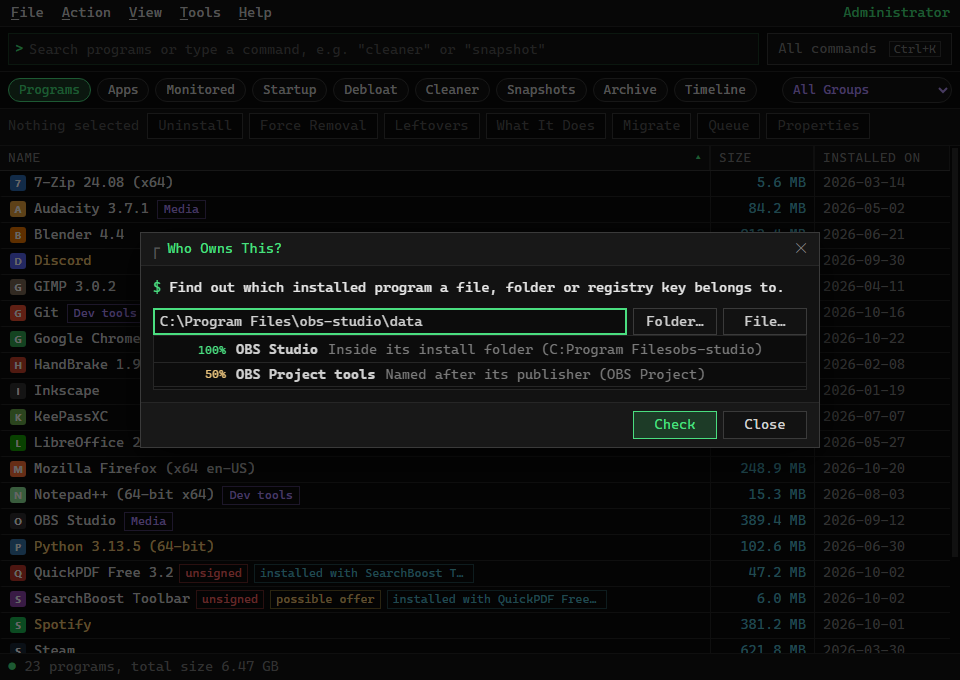

- **Tools › Who Owns This** tells you which installed program a file, folder or registry key belongs to, and how sure it is.
- It checks install folders, uninstall entries, monitored installations, and names along the path.
- Windows' and hardware vendors' shared folders are recognised as such.

## Orphaned leftovers and registry search

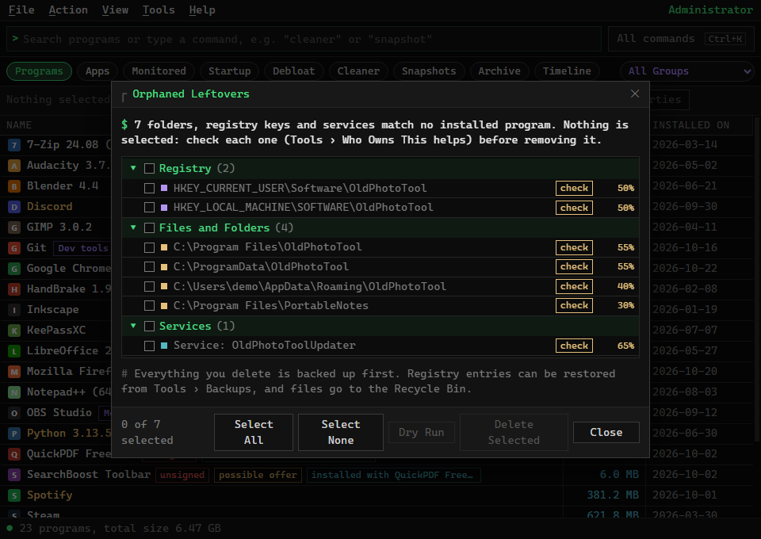

**Tools › Find Orphaned Leftovers** looks for folders, registry keys and services of programs that are no longer installed. It is careful:
- nothing is selected for you;
- Windows' own folders, anything an installed program uses and anything used in the last 30 days are left out;
- game saves in `AppData\LocalLow` are left out;
- AppData folders are marked as possibly holding settings or saved games;
- folders that contain programs are marked as possibly portable apps;
- a registry key is only offered next to a leftover folder of the same name;
- services whose program file no longer exists are offered too.

**Dry Run** shows what a removal would do, item by item, without changing anything:

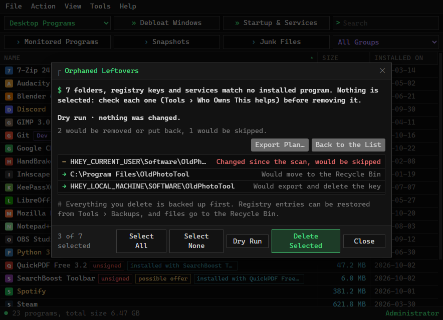

**Tools › Search Registry** finds registry keys named after a word, and values that mention it, in the `Software` branches of your user and the machine. Results go through the same protection rules as leftovers, start unticked, and are backed up before removal.

## Program updates

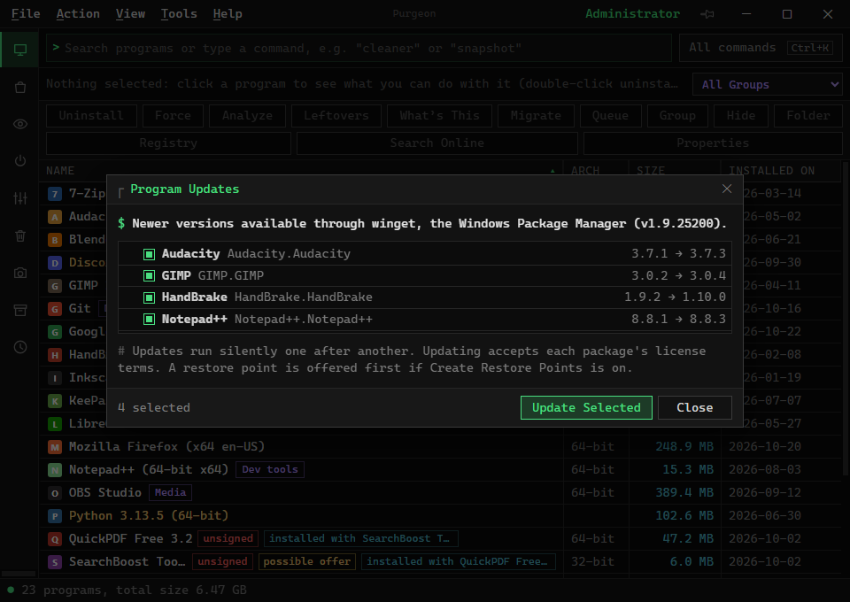

- **Tools › Program Updates** lists newer versions available through winget (the Windows Package Manager). It updates the ones you choose, silently, one after another, with a restore point offered first.
- **Tools › Export Program List** saves your programs as a winget list. On a new PC, `winget import -i <file>` installs them all.

## Portable apps

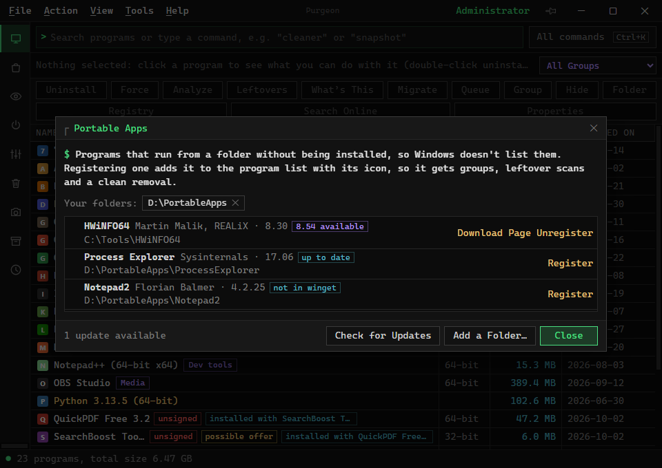

- **Tools › Portable Apps** finds programs that run from a folder without being installed, so Windows doesn't list them. It looks in Program Files, `C:\PortableApps`, `C:\Tools`, `C:\Apps` and the same names in your user folder.
- **Your own folders:** **Add a Folder** adds a folder that holds your portable apps, such as `D:\PortableApps`. It is remembered and looked at every time, both the folder itself and each folder inside it. The ✕ next to it stops looking there.
- **Updates:** **Check for Updates** looks each app up in winget's catalogue and shows **up to date**, the newer version available, or **not in winget**. For a newer version, **Download Page** opens the publisher's page. Purgeon doesn't replace a portable app's files itself: download the new version and unpack it over the folder, after backing the folder up.
- **Register** adds one to the program list with its icon, through a per-user uninstall entry marked as Purgeon's. It then gets groups, leftover scans and a clean removal like any installed program. **Unregister** removes only that entry.

## Cleaner

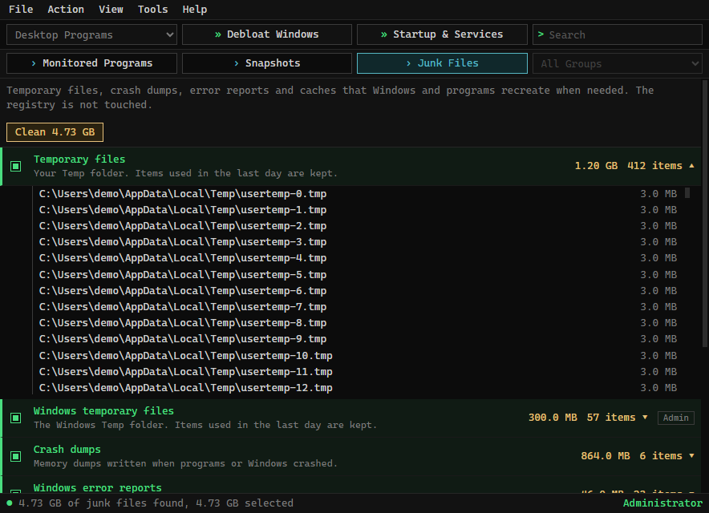

**Cleaner** (`Ctrl+8`) finds files that Windows and programs recreate when needed, with their sizes:
- temporary files (yours and Windows'), keeping anything used in the last day;
- crash dumps and Windows error reports;
- the Explorer thumbnail cache and DirectX shader caches;
- downloaded Windows Update files and the Delivery Optimization cache;
- data folders of Microsoft Store apps that are no longer installed (checked again right before removal).

**Privacy traces** are offered too, but never selected for you: the recent-files list, jump lists, and the icon cache. Only the shortcuts and caches are removed, never the files they point to.

**How cleaning works**
- Cleaned items go to the Recycle Bin, so a clean-up can be undone.
- Files in use are skipped, and the registry is never touched.
- Only the contents of these known folders are ever cleaned.

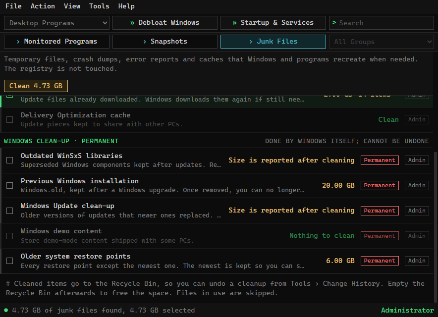

**Windows clean-up** uses Windows' own tools for:
- outdated WinSxS libraries (DISM);
- the previous Windows installation (Windows.old);
- Windows Update clean-up;
- Windows demo content;
- older system restore points (the newest is always kept).

These are permanent. They are never selected for you, need administrator rights, and have their own confirmation.

## Browser clean-up

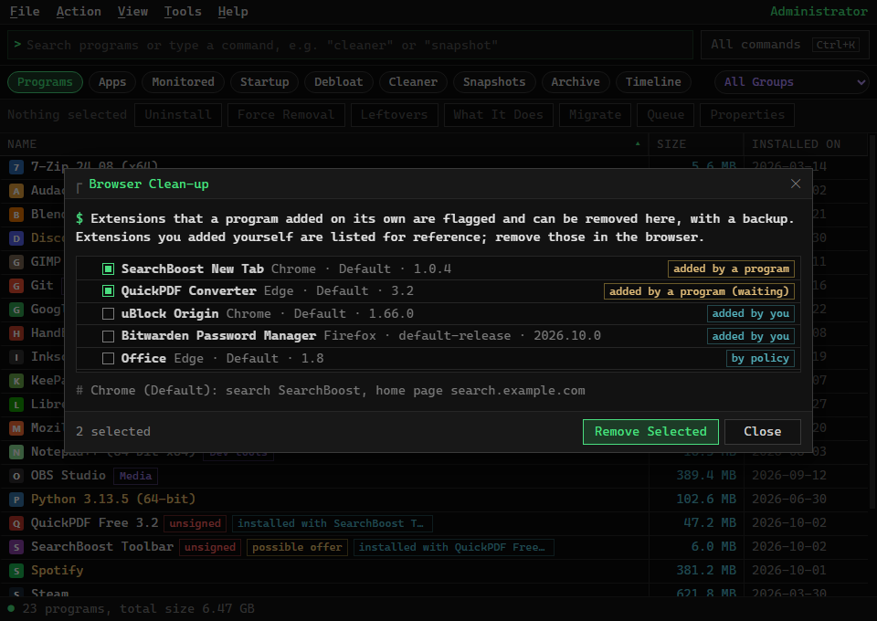

- **Tools › Browser Clean-up** lists the extensions, search engine and home page of Chrome, Edge, Brave and Firefox.
- Extensions that a **program added on its own** (through the registry, or into Firefox's shared folders) are flagged. That is how bundled offers arrive, and these can be removed here with a backup.
- Extensions you added yourself are listed for reference only; remove those in the browser, which keeps its own records right.
- Nothing is changed while that browser is running.

## Startup & Services

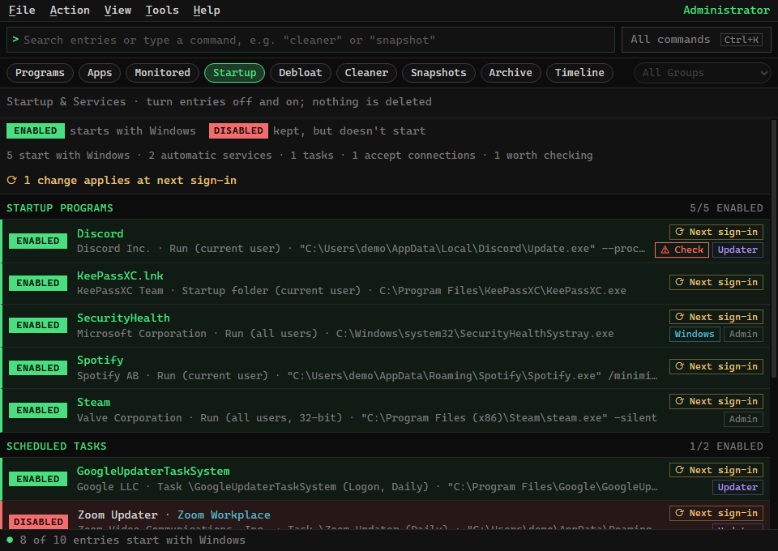

**Startup & Services** (`Ctrl+6`) shows everything that runs without you starting it:
- Run entries and Startup-folder shortcuts;
- scheduled tasks outside Windows' own `\Microsoft\` folder;
- third-party services that start automatically (only ones that can actually be changed);
- programs allowed to accept incoming connections through the firewall, each removable with a backup.

**For each entry it shows** its publisher, its command, the installed program it belongs to, whether it is digitally signed, whether it is an updater, and how many seconds Windows measured it adding to start-up (with administrator rights).

**Turning an entry off never deletes it:**
- Run entries and shortcuts use Windows' own switch, the same one Task Manager uses.
- Tasks are disabled.
- Services are set from Automatic to Manual, and their original mode is remembered.

Entries from Microsoft are tagged **Windows** and ask before being turned off.

**Trust check:** entries worth a second look are tagged, with the reasons on hover: running from a temporary, download or oddly named user folder, being unsigned, or being added recently.

**New-entry alerts:** when a program adds itself to what starts with Windows, Purgeon tells you with a Windows notification and offers **Allow** or **Turn Off**.

## Explorer context menu

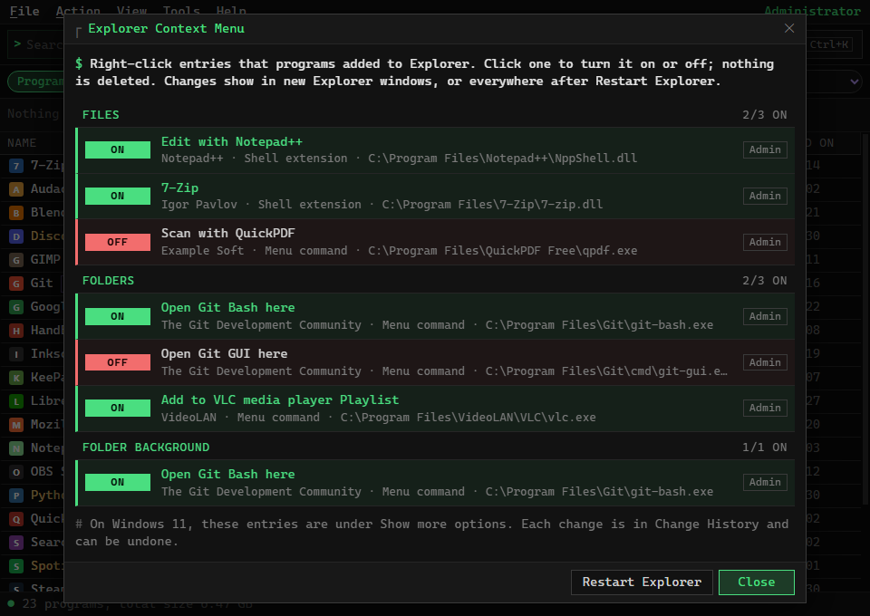

- **Tools › Explorer Context Menu Items** lists the right-click entries that programs added to Explorer, for files, folders, the folder and desktop background, and drives. Windows' own entries are left out.
- Click one to turn it off or on. Nothing is deleted: menu commands use Windows' own `LegacyDisable` switch, and shell extensions go on Windows' blocked list (that needs administrator rights).
- Changes show in new Explorer windows, or everywhere after **Restart Explorer**. Each one is in Change History and can be undone.

**Purgeon's own entries:** **Tools › Explorer Right-Click Menu** adds **Uninstall with Purgeon** for shortcuts and programs, and **Who owns this?** for files and folders. They are added for your user only, and turning the option off deletes exactly those keys again.

## Debloat

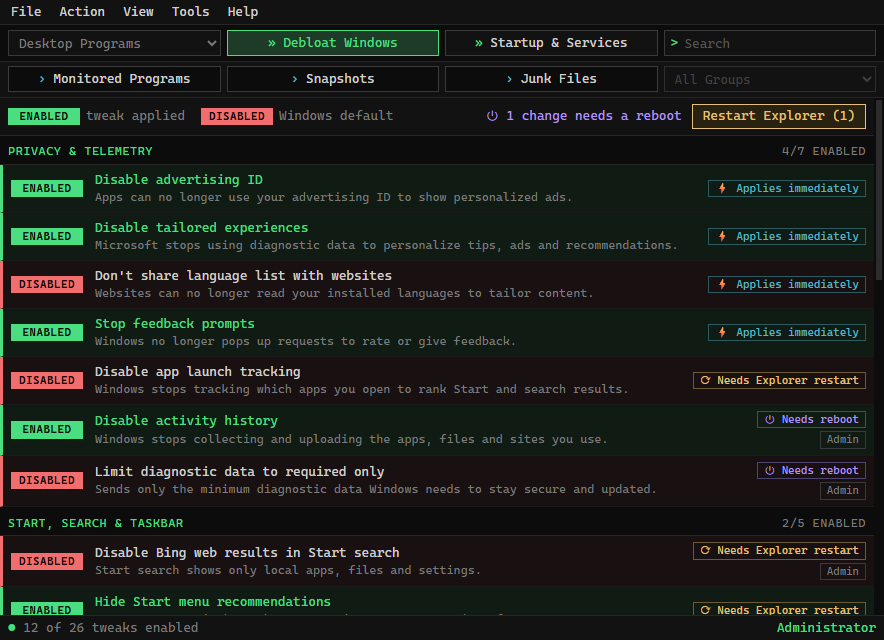

- **Tweaks:** **Debloat** (`Ctrl+5`) lists 26 safe, reversible tweaks in five groups: Privacy & telemetry, Start/search/taskbar, Ads & suggestions, Explorer & UI, and Windows Update.
- **On and off:** each is either **ENABLED** (green, applied) or **DISABLED** (red, Windows default). Turning one off puts back exactly the value you had before.
- **Timing:** each says when it takes effect: **Applies immediately**, **Needs Explorer restart** or **Needs reboot**.
- **What's left out:** no service removal, no app removal, and no security features turned off. Machine-wide policies are tagged **Admin**.

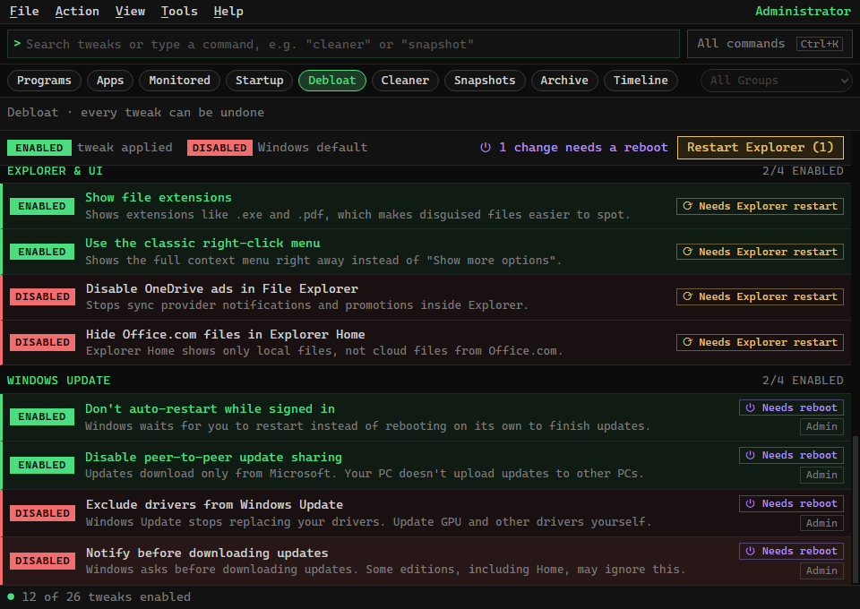

## Program groups

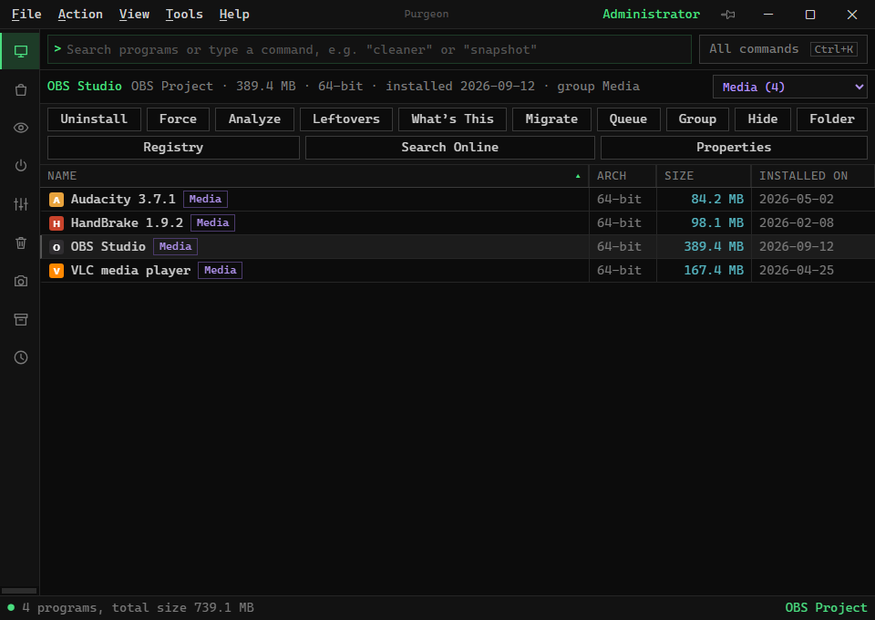

- **Setting a group:** right-click programs and choose **Set Group** (`Ctrl+G`) to file them under a name such as Games, Work or Media. The group shows as a tag.
- **Filtering:** the group list shows one group at a time, or only ungrouped programs, and searching matches group names.
- **Undo:** group changes can be undone from Change History.

## Scheduled maintenance, tray and reports

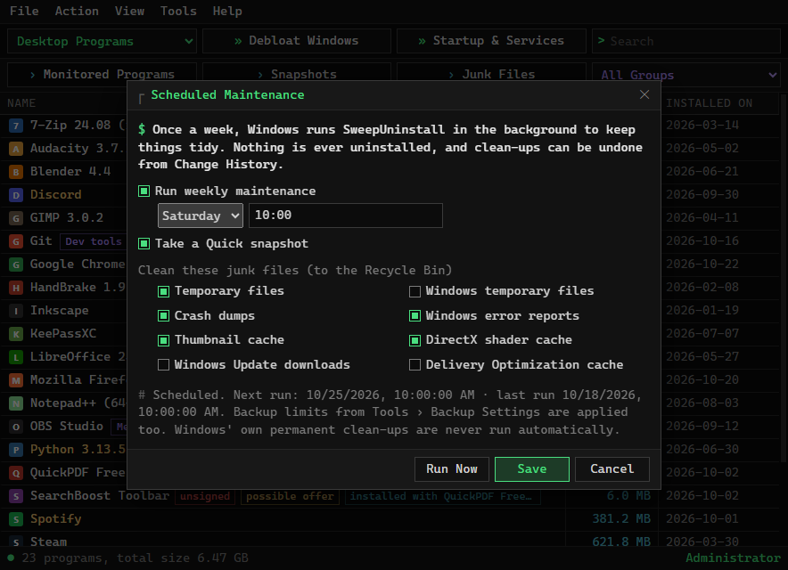

**Tools › Scheduled Maintenance** runs Purgeon once a week through Windows Task Scheduler. Each run:
- takes a Quick snapshot;
- cleans the junk categories you choose, to the Recycle Bin;
- applies your backup limits.

It never uninstalls anything and never runs the permanent Windows clean-ups. Each run writes a short report and appears in Change History.

**Window and tray** (all in the View menu):
- **Always on Top**, or the 📌 thumbtack in the title bar, keeps the window in front of other windows.
- **Minimize to Tray** hides the window in the notification area when you minimize it: the window and its taskbar button go away, and only the tray icon remains.
- **The close button** asks whether to **Minimize to Tray** (keep running there, still spotting installers and new startup entries) or **Exit**, with a **Remember my choice** box. **Close Button Asks**, **Close Button Hides to Tray** and **Close Button Exits** change the choice later.
- **Start Minimized to Tray** starts it hidden there.
- **Start with Windows** starts it when you sign in. Purgeon runs as administrator, and Windows skips such programs in its Run list, so this is a task in **Task Scheduler › Purgeon** that starts it at sign-in without a UAC prompt. Turning the option off deletes the task, and uninstalling Purgeon removes it too. The installer's last page offers it as well, unticked.

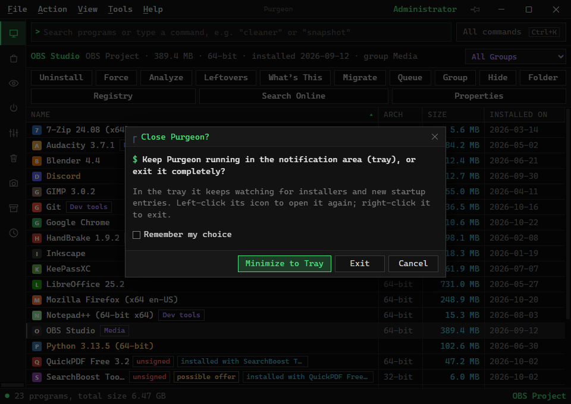

**The tray icon:** a left click shows the window. A right click opens a menu: Show Purgeon, Monitor an Installation, Cleaner, Startup & Services, Program Updates and Exit. The icon also reports finished maintenance runs, available updates, new startup entries and interrupted removals.

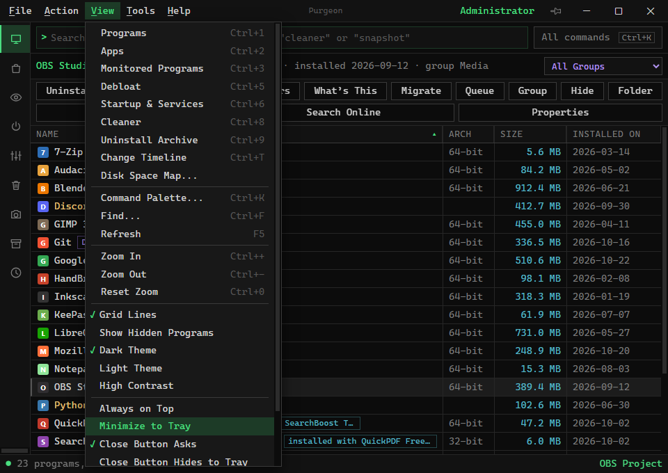

**Monthly report:** **File › Monthly Report** saves an HTML page for a month: programs installed and removed, space freed, startup changes, updates, clean-ups, and programs flagged by the insights.

## Themes and accessibility

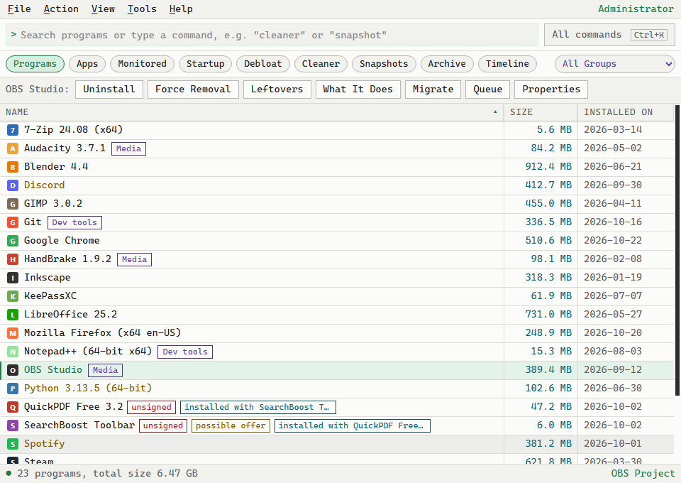

- **View** offers the **Dark** terminal theme, a **Light** theme and **High Contrast**.
- Every menu works from the keyboard: `Alt` plus a menu's underlined letter opens it, arrow keys move, `Enter` chooses and `Esc` closes. Everything that has focus shows a clear outline.
- Dialogs, menus, toolbars and lists carry roles and labels for screen readers.

## Safety, backups and undo

**Everything is backed up before it changes:**
- registry keys are exported to `.reg` files, and values are recorded with their type and data;
- scheduled tasks are exported to XML, and firewall rules and service definitions are saved;
- files go to the Recycle Bin.

**Undo:** **Tools › Change History** (`Ctrl+H`) lists every change and undoes it with a double-click. **Tools › Backups** (`Ctrl+4`) restores any removal. After a removal, the report has an **Undo** button.

**Checks before anything is deleted:**
- Purgeon never offers drive roots, the Windows folder, your profile folder, install roots, or generic folders such as `Microsoft` or `Common Files`.
- It refuses to delete registry keys Windows depends on, Windows' own services, and scheduled tasks under `\Microsoft\`.
- **Right before deleting** it checks again, and skips anything another installed program still uses, any file Windows counts as shared, and anything that changed after the scan. If that check can't run, nothing is deleted.

**Seeing and limiting what happens:**
- **Dry Run** shows exactly what a removal would do, and **Tools › Safe Mode** offers only near-certain matches.
- **Restore points:** before an uninstall, a batch or the first Debloat change, the confirmation offers to create one (**Tools › Create Restore Points** sets the default).
- **Crash-safe removals:** each item is in the backup before the next one is removed. After a crash or power cut, the next start offers to roll back, finish or leave the removal.
- **Fingerprinted backups:** backups are sealed with SHA-256 fingerprints, and a changed backup is not restored. **Tools › Backup Settings** can limit backups by age or size, always keeping each program's newest.
- **Command log:** **Tools › Open Command Log** shows every command Purgeon ran, with its result, for 14 days.
- **Tests:** an automated safety test suite runs on every build and blocks a release if it fails.

## Command line

```bash
Purgeon --snapshot "Before installing X" --preset quick
Purgeon --compare "Before installing X" now --report changes.html
Purgeon --list-snapshots
Purgeon --monitor "C:\Downloads\setup.exe" --name "Foo Editor"
Purgeon --maintenance
Purgeon --autostart on
Purgeon --help
```

**Options:**
- `--preset` is `quick`, `standard` (the default) or `deep`.
- A snapshot is named by its id, its name, or `latest`. Compare two snapshots, or one with `now`.
- `--report` saves a comparison as HTML, JSON or plain text, depending on the file extension.
- `--monitor` runs an installer, waits for it and saves the recording under Monitored Programs, with live tracking as administrator.
- `--maintenance` runs the weekly maintenance set up in Tools › Scheduled Maintenance.
- `--autostart on` or `off` turns View › Start with Windows on or off.
- `--tray` starts Purgeon hidden in the tray.

The exit code is 0 on success and 1 on an error. Run from an administrator terminal to see the output there.

Use one command at a time. Put quotes around names and paths that contain spaces, and
put the command before its options. Unknown options, repeated options, extra values,
and missing values are errors; Purgeon checks the whole request before starting the
operation. For example, `--maintenance --dry-run` is rejected: maintenance has no
`--dry-run` option. `--help` (also `-h` or `/?`) must be used on its own.
Names and other values cannot begin with a dash (`-`); use a full path for such a file.

Development validation and outstanding build checks are recorded in
[docs/DEVELOPMENT.md](docs/DEVELOPMENT.md).

## Download

Get published versions from [Releases](https://github.com/SeanShaffer88/Purgeon/releases/latest).
The next release uses the three files below. Existing releases retain their original
files. The new x86 build is tested on x64 Windows through Windows' compatibility
layer; a separate 32-bit Windows 10 runtime test is still outstanding.

- **`Purgeon-Setup.exe`** selects x86 on 32-bit Windows and x64 on 64-bit Windows.
  It installs for all users, with a Start Menu shortcut. Its last page offers to
  start Purgeon with Windows (unticked). Silent installation uses `/S`; an optional
  `/D=C:\Your Folder` must be last and unquoted.
- **`Purgeon-Setup.msi`** installs the **32-bit app on either x86 or x64 Windows**.
  Windows Installer does not support a single MSI declaring both native platforms.
  For the native x64 app, use the EXE. Silent installation uses
  `msiexec /i Purgeon-Setup.msi /qn /norestart`. Uninstall the current installation
  before switching installer formats. User data is retained.
- **`Purgeon-Portable.zip`** contains `Purgeon-Portable-x86.exe`,
  `Purgeon-Portable-x64.exe`, LICENSE, and PORTABLE.txt. Extract everything first,
  then run the executable matching Windows. Both builds share the adjacent
  `Purgeon Data` folder; run one at a time. Keep the whole folder when moving to
  another PC. Names containing `portable`, or a neighboring file named `portable`,
  enable this storage mode.

**Upgrading from SweepUninstall:** Purgeon is the same program under a new name.
- Your settings, backups, snapshots, groups and Change History carry over: Purgeon uses the same data folder.
- The installer puts Purgeon in its own `Program Files\Purgeon` folder. Afterwards, uninstall SweepUninstall from Windows Settings and leave **Delete the application data** unticked, because that folder is now Purgeon's.
- A portable copy keeps using its `SweepUninstall Data` folder until you rename it to `Purgeon Data`.
- Scheduled maintenance and Start with Windows tasks from SweepUninstall are replaced the next time you save those options.

**Requirements and notes:**
- **Administrator rights:** release executables ask for them when they start. Removing programs installed for all users, creating restore points, machine-wide tweaks and live install tracking need them. Development and default test builds run with the caller's existing rights.
- **WebView2:** Microsoft Edge WebView2 must be installed. Setup packages include its bootstrapper, which downloads the runtime if missing; that step needs internet access. Portable copies require an existing runtime.
- **Platform coverage:** Windows 10/11 x64 is the existing target. Native ARM64 builds are not included; Windows 11 has no x86 edition.
- **Lightweight:** while idle, Purgeon uses about 125–135 MB of memory, counting WebView2's helper processes.
- **SmartScreen:** the exes are not code-signed yet, so Windows SmartScreen may show "Windows protected your PC". Click **More info › Run anyway**.

## Keyboard shortcuts

| Key | Action |
| --- | --- |
| `Del` | Uninstall (all selected programs when several are selected) |
| `Shift+Del` | Force removal |
| `Ctrl+L` | Analyze leftovers |
| `Ctrl+click` / `Shift+click` / `Shift+arrows` / `Ctrl+A` | Select several programs |
| `Alt+Enter` / `Enter` | Properties |
| `Ctrl+F` | Search, or type a command |
| `Ctrl+K` | Command palette |
| `Ctrl+G` | Set group |
| `Ctrl+Q` | Add to the uninstall queue |
| `Ctrl+W` | What’s This |
| `Ctrl+I` | Analyze the selected program |
| `Ctrl+1` / `Ctrl+2` | Programs / Apps |
| `Ctrl+3` | Monitored Programs |
| `Ctrl+4` | Backups |
| `Ctrl+5` | Debloat |
| `Ctrl+6` | Startup & Services |
| `Ctrl+7` | Snapshots |
| `Ctrl+8` | Cleaner |
| `Ctrl+9` | Uninstall Archive |
| `Ctrl+T` | Change timeline |
| `Alt` + underlined letter | Open a menu |
| `Ctrl+M` | Monitor an installation |
| `Ctrl+H` | Change History |
| `Ctrl++` / `Ctrl+-` / `Ctrl+0` | Zoom in / out / reset |
| `Ctrl+S` | Export the list to HTML |
| `F5` | Refresh |

## Run from source

Requirements: Windows 10 or 11, [Node.js](https://nodejs.org/) 24, [Rust](https://rustup.rs/) (stable), and the MSVC desktop C++ build tools. Packaging also needs PowerShell 7 and the Windows VBScript optional component for WiX validation.

```bash
git clone https://github.com/SeanShaffer88/Purgeon.git
cd Purgeon
npm install
npm run dev
```

`npm test` runs the JavaScript safety tests. Native check commands are in
[AGENTS.md](AGENTS.md). `npm run dist` builds a single native NSIS bundle.
For the complete distribution, install both Rust targets with
`rustup target add i686-pc-windows-msvc x86_64-pc-windows-msvc`, then run
`npm run dist:windows`. The output directory must be empty; existing files are
never silently removed. CI runs the native gates on both targets, builds the three
assets, tests silent install/uninstall on its disposable x64 runner, then downloads
and verifies the artifact again. A version tag publishes those three files only.
The internal hash manifest is CI evidence and is not a separate release asset.

## How it works

| File | Role |
| --- | --- |
| `src-tauri/src/lib.rs` | Small Rust core: runs PowerShell and system tools, reads folders and sizes, Recycle Bin moves, hashing, portable mode and command-line output |
| `src-tauri/src/snapshot.rs` | Snapshot engine: records files, folders, registry keys and values into a compressed file, and compares two snapshots |
| `src-tauri/src/tracker.rs` | Live installation tracking with Event Tracing for Windows |
| `src/backend/programs.js` | Installed programs and Store apps, and their icons |
| `src/backend/leftovers.js`, `deepscan.js` | Leftover scan and match scores |
| `src/backend/installers.js` | Installer types, silent uninstall, and files listed by Windows Installer and Inno Setup |
| `src/backend/backups.js` | Backup, removal, dry run, crash recovery, fingerprints, limits and restore |
| `src/backend/safety.js` | The check right before deleting, and dependency warnings |
| `src/backend/monitor.js`, `snapshots.js` | Installation monitor and snapshots |
| `src/backend/transfer.js` | Program migration packages |
| `src/backend/insights.js` | Signatures, programs installed together, bundled-offer names and size history |
| `src/backend/owners.js` | Who owns a path or key, and the orphan finder |
| `src/backend/winget.js`, `archive.js` | Program updates and the uninstall archive |
| `src/backend/junk.js` | Junk files and Windows clean-up |
| `src/backend/startup.js`, `running.js` | Startup & Services, boot delays and inbound firewall rules |
| `src/backend/debloat.js`, `restore.js` | Debloat tweaks and restore points |
| `src/backend/maintenance.js`, `log.js`, `history.js`, `groups.js` | Scheduled maintenance, command log, Change History and groups |
| `src/backend/queue.js`, `trials.js` | Uninstall queue with restart resume, and trial installs |
| `src/backend/explore.js` | Disk space map, change timeline, "what it does" sheet and registry search |
| `src/backend/browsers.js`, `portable.js` | Browser clean-up and portable apps |
| `src/backend/ctxmenu.js`, `shellmenu.js` | Explorer context menu items, and Purgeon's own right-click entries |
| `src/backend/report.js` | Monthly report |
| `src/backend/installwatch.js`, `autostart.js` | Spotting installers as they start, and Start with Windows |
| `src/tips.js` | Tooltip text for every command and button |
| `src-tauri/windows/installer.nsi`, `hooks.nsh` | Tauri's installer template with the Start with Windows box, and removing the scheduled tasks on uninstall |
| `src/backend/paths.js` | Install roots, and guards that refuse to touch system folders |
| `src/*.jsx`, `src/cli.js` | React UI and the command line |
| `test/` | Safety tests (`node --test`) against the same backend code |

## Limitations

- **Snapshot depth:** snapshots record to a fixed depth (six levels for Standard, ten for Deep); live tracking covers any depth during monitored installs.
- **File contents:** snapshots don't store file contents, so changed files are listed but can't be put back.
- **Other activity:** changes made by other programs during monitoring, or between snapshots, are listed too. Review before cleaning up.
- **Recycle Bin:** files can be restored only while they are still in the Recycle Bin, and files the Cleaner moved there take space until it is emptied.
- **Trials:** Try Over removes what changed since the trial's snapshot, so changes made by other programs during a trial are listed too.
- **Services:** a restored service comes back after a restart.

## Roadmap

Planned enhancements are listed in [docs/ROADMAP.md](docs/ROADMAP.md).

## Disclaimer

Purgeon is an independent project, written from scratch using documented Windows APIs.
It is not affiliated with any other uninstaller and contains no code from one.
Uninstalling software changes your system, so review what is selected before deleting.

## License

[MIT](LICENSE)
